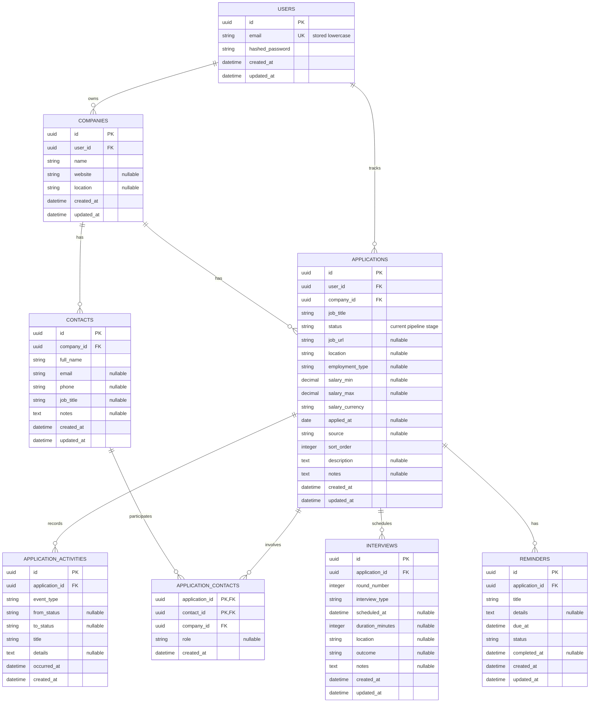

# Data Model

PostgreSQL schema for the job tracker. UUIDs are used for primary keys and timestamps use `TIMESTAMPTZ`. Required fields are `NOT NULL` unless marked nullable below.

## MVP and later phases

| Phase | Tables | Purpose |
| --- | --- | --- |
| MVP | `users` | Account and owner of tracker data. |
| MVP | `companies` | Employers saved by a user and reused across applications. |
| MVP | `applications` | Job opportunities and their current pipeline status. |
| MVP | `application_activities` | Notes and events, including status transitions for timeline and stage-duration reporting. |
| Later | `contacts`, `application_contacts` | Company people and their links to applications. |
| Later | `interviews` | Structured interview scheduling and outcomes. |
| Later | `reminders` | Follow-up tasks and due dates. |

## Entity relationship diagram

## Columns and constraints

`created_at` and `updated_at` default to `CURRENT_TIMESTAMP`; SQLAlchemy refreshes `updated_at` with `onupdate=func.now()` for ORM updates. Raw SQL updates must set `updated_at` explicitly. UUIDs are generated with `gen_random_uuid()`.

### `users` (MVP)

| Column | PostgreSQL type | Null? | Key / default / constraint |
| --- | --- | --- | --- |
| `id` | `UUID` | No | Primary key |
| `email` | `VARCHAR(320)` | No | Unique; normalize to lowercase |
| `hashed_password` | `VARCHAR(255)` | No | Store a password hash, never a plaintext password |
| `created_at` | `TIMESTAMPTZ` | No | `CURRENT_TIMESTAMP` |
| `updated_at` | `TIMESTAMPTZ` | No | `CURRENT_TIMESTAMP`; refresh on update |

### `companies` (MVP)

| Column | PostgreSQL type | Null? | Key / default / constraint |
| --- | --- | --- | --- |
| `id` | `UUID` | No | Primary key |
| `user_id` | `UUID` | No | FK → `users.id`, `ON DELETE CASCADE` |
| `name` | `VARCHAR(200)` | No | Trim and normalize before saving |
| `website` | `VARCHAR(2048)` | Yes | |
| `location` | `VARCHAR(200)` | Yes | |
| `created_at` | `TIMESTAMPTZ` | No | `CURRENT_TIMESTAMP` |
| `updated_at` | `TIMESTAMPTZ` | No | `CURRENT_TIMESTAMP`; refresh on update |

Unique constraint: (`user_id`, `name`) after name normalization. Also declare a unique constraint on (`user_id`, `id`) so applications can reference a company and its owner together.

### `applications` (MVP)

| Column | PostgreSQL type | Null? | Key / default / constraint |
| --- | --- | --- | --- |
| `id` | `UUID` | No | Primary key |
| `user_id` | `UUID` | No | FK → `users.id`, `ON DELETE CASCADE` |
| `company_id` | `UUID` | No | Part of composite FK (`user_id`, `company_id`) → `companies` (`user_id`, `id`), `ON DELETE NO ACTION DEFERRABLE INITIALLY DEFERRED` |
| `job_title` | `VARCHAR(200)` | No | |
| `status` | `VARCHAR(20)` | No | Default `saved`; CHECK: `saved`, `applied`, `screening`, `interviewing`, `offer`, `rejected`, `withdrawn` |
| `job_url` | `VARCHAR(2048)` | Yes | |
| `location` | `VARCHAR(200)` | Yes | |
| `employment_type` | `VARCHAR(30)` | Yes | CHECK: `full_time`, `part_time`, `contract`, `internship`, `temporary`, `other` |
| `salary_min` | `NUMERIC(12,2)` | Yes | Must be non-negative |
| `salary_max` | `NUMERIC(12,2)` | Yes | Must be non-negative and >= `salary_min` when both are set |
| `salary_currency` | `CHAR(3)` | No | Default `USD`; ISO 4217 currency code |
| `applied_at` | `DATE` | Yes | |
| `source` | `VARCHAR(120)` | Yes | For example, referral or job board |
| `sort_order` | `INTEGER` | No | Default `0`; controls card order within a status column |
| `description` | `TEXT` | Yes | |
| `notes` | `TEXT` | Yes | |
| `created_at` | `TIMESTAMPTZ` | No | `CURRENT_TIMESTAMP` |
| `updated_at` | `TIMESTAMPTZ` | No | `CURRENT_TIMESTAMP`; refresh on update |

Add an index on (`user_id`, `status`, `sort_order`) for the user's kanban view.

Also declare a unique constraint on (`id`, `company_id`) for the later-phase composite foreign key from `application_contacts`.

### `application_activities` (MVP)

| Column | PostgreSQL type | Null? | Key / default / constraint |
| --- | --- | --- | --- |
| `id` | `UUID` | No | Primary key |
| `application_id` | `UUID` | No | FK → `applications.id`, `ON DELETE CASCADE` |
| `event_type` | `VARCHAR(20)` | No | CHECK: `status_changed`, `note`, `email`, `call`, `other` |
| `from_status` | `VARCHAR(20)` | Yes | Previous status for a transition; null only for the initial status event |
| `to_status` | `VARCHAR(20)` | Yes | New status for a transition; required for `status_changed` events |
| `title` | `VARCHAR(200)` | No | |
| `details` | `TEXT` | Yes | |
| `occurred_at` | `TIMESTAMPTZ` | No | Defaults to `CURRENT_TIMESTAMP`; event time used for stage-duration reporting |
| `created_at` | `TIMESTAMPTZ` | No | `CURRENT_TIMESTAMP` |

For `status_changed` events, require `to_status` and apply the same allowed-status CHECK as `applications.status` to both status columns. `from_status` is null only on the initial status event; create this event with `to_status` equal to the application's starting status in the same transaction as the application insert. This handles imported applications that start in a later stage without inferring their initial duration from `applications.created_at`. Other event types leave both status fields null. Add an index on (`application_id`, `occurred_at`) and a unique partial index on (`application_id`) where `event_type = 'status_changed' AND from_status IS NULL` so an application has at most one initial status event.

### `contacts` (later)

| Column | PostgreSQL type | Null? | Key / default / constraint |
| --- | --- | --- | --- |
| `id` | `UUID` | No | Primary key |
| `company_id` | `UUID` | No | FK → `companies.id`, `ON DELETE CASCADE` |
| `full_name` | `VARCHAR(200)` | No | |
| `email` | `VARCHAR(320)` | Yes | |
| `phone` | `VARCHAR(40)` | Yes | |
| `job_title` | `VARCHAR(160)` | Yes | |
| `notes` | `TEXT` | Yes | |
| `created_at` | `TIMESTAMPTZ` | No | `CURRENT_TIMESTAMP` |
| `updated_at` | `TIMESTAMPTZ` | No | `CURRENT_TIMESTAMP`; refresh on update |

### `application_contacts` (later)

| Column | PostgreSQL type | Null? | Key / default / constraint |
| --- | --- | --- | --- |
| `application_id` | `UUID` | No | Part of composite primary key; FK → `applications.id`, `ON DELETE CASCADE` |
| `contact_id` | `UUID` | No | Part of composite primary key; FK → `contacts.id`, `ON DELETE CASCADE` |
| `company_id` | `UUID` | No | FK pair component; both referenced records must belong to this company |
| `role` | `VARCHAR(80)` | Yes | Contact's role for this application, such as recruiter |
| `created_at` | `TIMESTAMPTZ` | No | `CURRENT_TIMESTAMP` |

Declare unique constraints on (`id`, `company_id`) in `contacts` and composite foreign keys (`application_id`, `company_id`) → `applications` (`id`, `company_id`) and (`contact_id`, `company_id`) → `contacts` (`id`, `company_id`). This ensures an application can only be linked to a contact at that same company.

### `interviews` (later)

| Column | PostgreSQL type | Null? | Key / default / constraint |
| --- | --- | --- | --- |
| `id` | `UUID` | No | Primary key |
| `application_id` | `UUID` | No | FK → `applications.id`, `ON DELETE CASCADE` |
| `round_number` | `INTEGER` | No | Must be >= 1 |
| `interview_type` | `VARCHAR(30)` | No | For example, phone, video, onsite, or take_home |
| `scheduled_at` | `TIMESTAMPTZ` | Yes | Null until scheduled |
| `duration_minutes` | `INTEGER` | Yes | Must be > 0 when set |
| `location` | `VARCHAR(500)` | Yes | Address or meeting link |
| `outcome` | `VARCHAR(20)` | Yes | CHECK: `pending`, `passed`, `failed`, `cancelled` |
| `notes` | `TEXT` | Yes | |
| `created_at` | `TIMESTAMPTZ` | No | `CURRENT_TIMESTAMP` |
| `updated_at` | `TIMESTAMPTZ` | No | `CURRENT_TIMESTAMP`; refresh on update |

### `reminders` (later)

| Column | PostgreSQL type | Null? | Key / default / constraint |
| --- | --- | --- | --- |
| `id` | `UUID` | No | Primary key |
| `application_id` | `UUID` | No | FK → `applications.id`, `ON DELETE CASCADE` |
| `title` | `VARCHAR(200)` | No | |
| `details` | `TEXT` | Yes | |
| `due_at` | `TIMESTAMPTZ` | No | |
| `status` | `VARCHAR(20)` | No | Default `pending`; CHECK: `pending`, `completed`, `dismissed` |
| `completed_at` | `TIMESTAMPTZ` | Yes | Set when status becomes `completed` |
| `created_at` | `TIMESTAMPTZ` | No | `CURRENT_TIMESTAMP` |
| `updated_at` | `TIMESTAMPTZ` | No | `CURRENT_TIMESTAMP`; refresh on update |

Add an index on (`status`, `due_at`) to find pending reminders that are due.

## Design decisions

- **Tenant isolation and contacts:** Applications reference a company through a composite (`user_id`, `company_id`) foreign key, preventing cross-user company links at the database level. Contacts have no direct `user_id`; ownership is derived through `contacts.company_id → companies.user_id`, so contact queries must join through the company and filter by its owner. Composite foreign keys also ensure application-contact links stay within one company.
- **Interviews versus activities:** Interviews store structured scheduling, round, and outcome data; activities record the chronological timeline, including status changes and communications. This keeps interview queries reliable without limiting the activity log to interviews.
- **Current status versus history:** `applications.status` is the current value for fast kanban filtering. Each transition is also an `application_activities` row with `from_status`, `to_status`, and `occurred_at`; transitions should be recorded transactionally with the current status update. Application creation also writes an initial event (`from_status = NULL`, `to_status = status`), so stage durations can be calculated from the event history, including for imports.
- **Deletion:** Deleting a user cascades to their companies and applications; deleting an application cascades to its activities and later-phase child rows. The composite application-to-company FK uses deferred `NO ACTION`, allowing the user-delete statement's cascades to remove both rows before the constraint is checked at transaction end. No soft deletion in the MVP.
- **Identifiers:** UUID primary keys are used instead of sequential integers because they are difficult to guess and remain unique across imports or future distributed components; PostgreSQL generates them with `gen_random_uuid()`.
- **`updated_at` maintenance:** SQLAlchemy's `onupdate=func.now()` refreshes this timestamp for ORM updates, avoiding a database trigger in the MVP. Updates issued as raw SQL must set `updated_at` explicitly.
