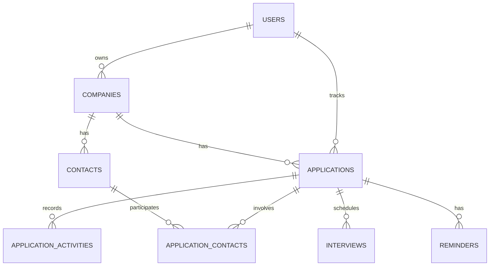

# Data Model

## Entities

| Table | Purpose |
| --- | --- |
| `users` | Account that owns and isolates a tracker’s data. |
| `companies` | Employers saved by a user and reused across applications. |
| `applications` | A job opportunity at a company, including its current pipeline status. |
| `contacts` | Recruiters, hiring managers, and other people associated with a company. |
| `application_contacts` | Join table for the many-to-many relationship between applications and contacts. |
| `application_activities` | Timeline entries such as notes, messages, and status changes. |
| `interviews` | Scheduled interview rounds, with their date, type, and outcome. |
| `reminders` | Follow-up tasks and due dates associated with an application. |

<!-- Keep application status as a constrained field on `applications` for the initial version; promote statuses to their own table only if users need customizable pipelines. -->

## Relationships

